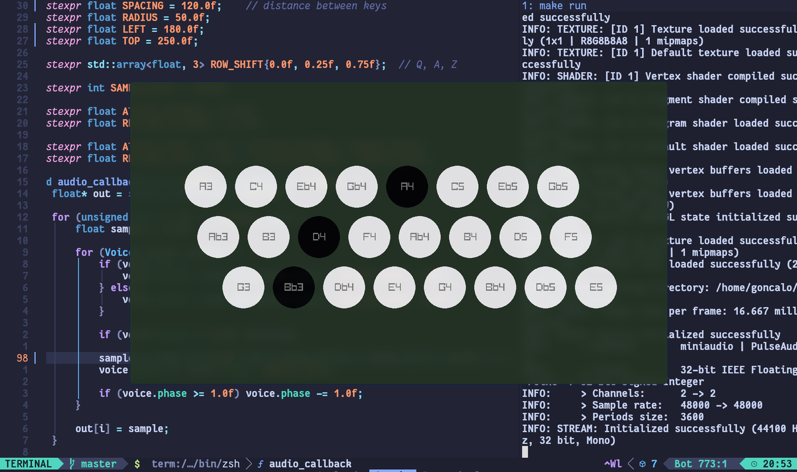

# qwerty-synth


I used to carry my saxophone everywhere. These days my laptop is always in my backpack, so I'm turning it into an instrument.

It's a small synthesizer in C++ with [raylib](https://www.raylib.com/), played entirely on the laptop keyboard. The keys follow a chromatic button accordion layout instead of a piano.

I wrote about it here: [I'm Learning a New Instrument](https://goncalo-soares.com/blog/qwerty-synth/).



## Layout

```
 Q row:   Q    W    E    R    T    Y    U    I
          A3   C4   Eb4  Gb4  A4   C5   Eb5  Gb5

 A row:    A    S    D    F    G    H    J    K
           Ab3  B3   D4   F4   Ab4  B4   D5   F5

 Z row:      Z    X    C    V    B    N    M    ,
             G3   Bb3  Db4  E4   G4   Bb4  Db5  E5
```

- the slanted columns are chromatic: `Z A Q` are all a semitone apart, then `X S W`, `C D E` and so forth
- one key to the right is a minor third, four keys to the right is an octave
- shapes are easy to move: G major is `Z S D`, and the same shape one key to the right, `X D F`, is Bb major

Some three-key chords won't sound on a laptop keyboard. That's ghosting, and it depends on your keyboard.

## Building

Requires a C++23 compiler, make and raylib. US QWERTY layout.

```sh
# Arch Linux
sudo pacman -S raylib

make run
```

## What's next

More sounds, effects, and recording and layering tracks. I don't know how far I'll take it.
